# Multilingual Captions (AssemblyAI)

Caption a video in **20+ languages, or two at once** (Japanese on top, English underneath), in your own font, and
open it in **Final Cut Pro, DaVinci Resolve or Premiere Pro**. Powered by [AssemblyAI](https://www.assemblyai.com)
Speech-to-Text (`universal-3-5-pro`, with code-switching for speech that mixes languages). Each word shows up grey as
it's spoken and turns white when it ends.

Every style, frozen mid-line so you can see words landing. Spanish, French, German, Portuguese, Italian, Japanese,
Korean and Mandarin are real AssemblyAI output (transcription and translation) on speech written for this repo;
English, Arabic, Hindi and Hinglish are written samples:

| | |
|---|---|
| 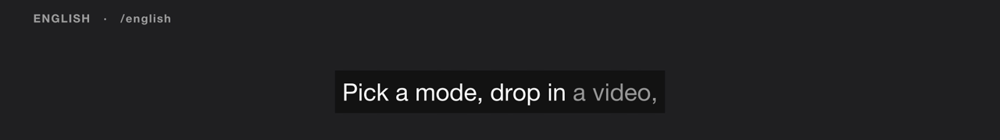 | 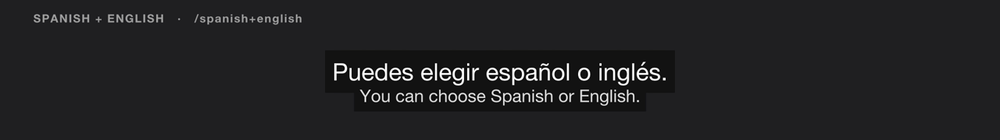 |
| 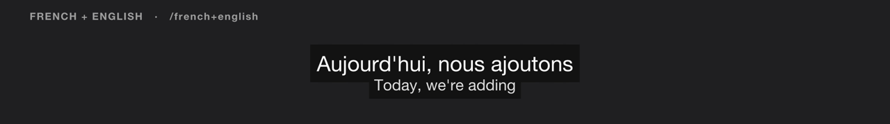 | 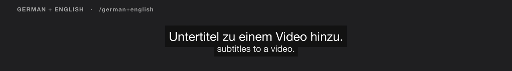 |
| 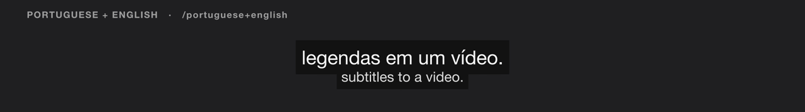 | 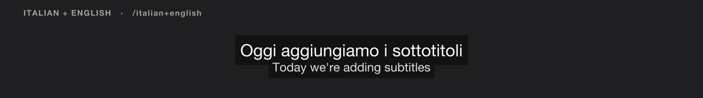 |
| 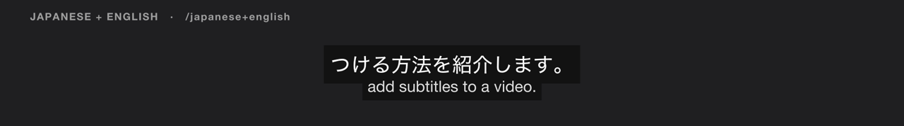 | 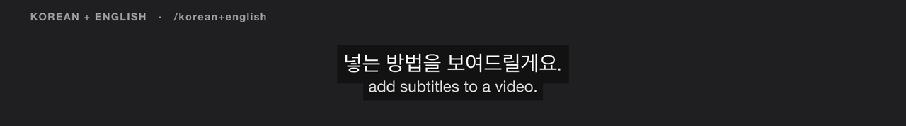 |
| 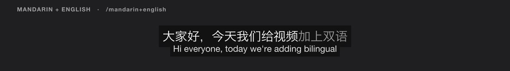 | 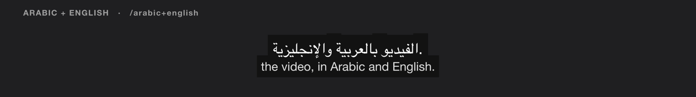 |
| 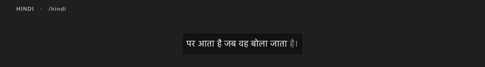 | 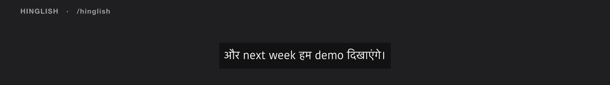 |
| 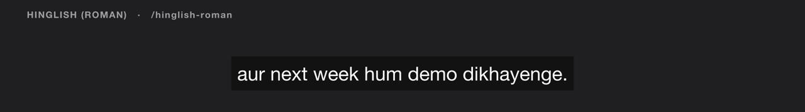 | |

Try it without a key: open [`demo.html`](demo.html) in a browser.

## Live captions

Captions of your own mic, live, with AssemblyAI realtime Speech-to-Text: a transparent overlay for OBS or Streamlabs, an
always-on-top window to share in Zoom, Meet or Teams, or full screen on a stage display.

```bash
python3 live/server.py
```

Open http://localhost:8787. Dev mode uses your `ASSEMBLYAI_API_KEY`, which never reaches the browser. "Sign in with
AssemblyAI", where each visitor uses their own account, needs a one-time approval from AssemblyAI. Captioning sends
speech to AssemblyAI while it's on, so tell people and get consent where required. See [live/README.md](live/README.md).

## In Claude Code

Open this folder in Claude Code and run a command with your video:

```
/japanese+english ~/Movies/talk.mov
```

The agent asks which **font** and which **editor** you want, transcribes, and hands you the project. Ready commands:

| | |
|---|---|
| Single language | `/english` `/spanish` `/french` `/german` `/portuguese` `/italian` `/japanese` `/korean` `/mandarin` `/hindi` `/arabic` `/vietnamese` `/russian` `/turkish` |
| Dual (two lines) | `/spanish+english` `/french+english` `/german+english` `/portuguese+english` `/japanese+english` `/korean+english` `/mandarin+english` `/hindi+english` `/arabic+english` `/english+spanish` `/english+mandarin` |
| Hindi + English | `/hinglish` (each language in its own script) · `/hinglish-roman` (all in the English alphabet) |

Any other pair works too: ask for "captions in Dutch with Turkish underneath". The workflow lives in
[`.claude/skills/captions/SKILL.md`](.claude/skills/captions/SKILL.md); the commands are generated from
`captions/languages.py` by `scripts/make_commands.py`.

## On the command line

Python 3.10+, standard library only. `ffmpeg`/`ffprobe` for editor projects.

```bash
git clone https://github.com/AssemblyAI-Marketing/captions.git
```

```bash
cd captions && cp .env.example .env
```

Put your [AssemblyAI API key](https://www.assemblyai.com/dashboard) in `.env`, then:

```bash
python3 -m captions talk.mp4 --mode japanese+english --font "Hiragino Sans" --editor finalcut
```

Next to the video, for each mode:

| File | |
|---|---|
| `talk.<mode>.srt`, `.vtt` | Captions for YouTube, X, LinkedIn or any player |
| `talk.<mode>.ass` | Styled, word-by-word captions for burn-in |
| `talk.<mode>.fcpxmld` | `--editor finalcut`: FCPXML 1.11, your video plus real Final Cut captions in your font |
| `talk.<mode>.resolve.fcpxml` | `--editor resolve`: FCPXML 1.10 (File › Import › Timeline), plus the `.srt` (File › Import › Subtitle) |
| `talk.<mode>.premiere.xml` | `--editor premiere`: a sequence (File › Import), plus the `.srt`, which Premiere imports as a caption track |
| `talk.<mode>.overlay.mov` | `--overlay`: the styled captions as ProRes 4444 with alpha, on the track above the video in each project |
| `talk.preview.html` | The video with every mode's captions, in a browser |

| Flag | |
|---|---|
| `--mode` | A language, or two joined with `+`. Repeatable. `python3 -m captions modes` lists them |
| `--font`, `--font2` | First and second line fonts: a family name, a file, or a font in `fonts/` |
| `--editor` | `finalcut`, `resolve`, `premiere` or `all`. Repeatable |
| `--overlay`, `--burn` | Styled captions with alpha in each project, or burned into a copy of the video (needs ffmpeg with libass) |
| `--keyterm` | A name or product to transcribe exactly, e.g. `--keyterm AssemblyAI`. Repeatable |
| `--transcript` | Use an existing transcript (API or MCP) instead of transcribing |
| `--llm agent` | Let your agent do the translation instead of LLM Gateway (see below) |
| `--style` | Look of the overlay and burn-in: `default`, `high-contrast` or `social` (see [Styles](#styles)) |
| `--speaker-names` | `never` (default), `change` or `always`: who's speaking, from the transcript, coloured per speaker |
| `--aspect` | Use the profile for another shape than the video's, e.g. `9:16` for a URL or a crop you'll make later |
| `--glue`, `--max-width` | Keep a phrase on one line; line length in columns (Chinese, Japanese and Korean count double; default from the video's shape) |

The transcript is cached as `talk.<language>.transcript.json`, so adding modes later doesn't transcribe again.

## Vertical and horizontal video

Captions follow the video's shape (read with `ffprobe`). One line shows at a time; a dual mode's translation is the
second line.

| | 16:9 | 9:16 |
|---|---|---|
| Line length | 42 columns | 22 columns |
| Reading speed | up to 17 characters a second | up to 15 |
| On screen | 1–7 s per caption | 0.8–5 s |
| Placement | 8% up from the bottom | 22% up, clear of the app's buttons, text sized to the width |

Shapes in between (1:1, 4:5) get values in between. A caption stays up long enough to read when the silence after
it allows, a pause of a second or more leaves the screen blank, and slow speech is split so no caption overstays.
`--max-width` still sets the line length. The profiles and timing rules are adapted from
[Overtone](https://github.com/lonthq/overtone-captions) (MIT).

## Styles

`--style` sets the look of the `.ass` file, the `--overlay` and `--burn`:

| | |
|---|---|
| `default` | White on a dark box; each word turns from grey to white as it's spoken |
| `high-contrast` | Yellow on solid black (17:1), bigger and bold, whole lines with no motion; nothing depends on colour |
| `social` | Heavy white type with an outline, upcoming words faint, up to two key words per line in dark type on yellow |

`social` picks key words with one more LLM Gateway request (or, with `--llm agent`, in the same
`talk.<mode>.llm-request.json` as any translation). `--speaker-names change` writes the speaker's name above the
line when the speaker changes (`always`: on every line), coloured per speaker, and as `<v Speaker A>` in the `.vtt`.
Names come from the transcript's speaker labels (A, B…, or real names from speaker identification).

| | |
|---|---|
|  | 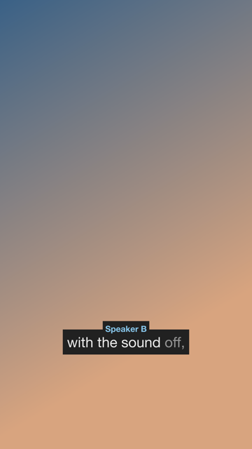 |
|  |  |
|  | 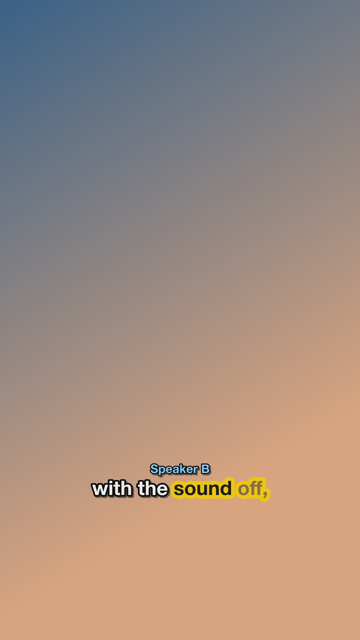 |

## Fonts

No fonts ship with this repo. Captions use a font already on your computer (a sensible default per script), or one
you drop into [`fonts/`](fonts/) (git-ignored). `python3 -m captions fonts --mode japanese+english` lists the
defaults, what's in `fonts/`, and open-source picks such as Noto Sans JP and Atkinson Hyperlegible (SIL Open Font
License). The family name is read from the font file, so Final Cut, the overlay, burn-in and the preview all match.

## With the AssemblyAI MCP server

No API key on hand? The captions skill can transcribe through the [AssemblyAI MCP server](https://github.com/AssemblyAI/assemblyai-mcp):

1. `python3 -m captions plan talk.mp4 --mode japanese+english` makes an upload-sized audio file (under 4.5 MB) and
   prints the `submit_transcript` parameters.
2. The agent uploads it with `create_upload_url`, calls `submit_transcript`, polls `get_transcript`, and saves the
   result as JSON.
3. `python3 -m captions talk.mp4 --mode japanese+english --transcript talk.mcp-transcript.json --llm agent`

The MCP server returns sentence timings rather than word timings, so captions are timed per sentence with the words
spread across it; an API key gives word-exact timing. Translation and Hinglish romanizing normally use AssemblyAI's
LLM Gateway; with `--llm agent` the CLI writes them to `talk.<mode>.llm-request.json` and exits with code 3, the
agent answers in `talk.<mode>.llm-answers.json`, and the same command finishes the job.

## How it works

1. **Transcribe** with `universal-3-5-pro` (falling back to `universal-2` for languages outside it). A pair with
   English, like `japanese+english`, uses code-switching (`language_codes: ["ja", "en"]`).
2. **Break lines** at speaker changes, pauses and sentence ends, then into the fewest, most even lines that fit the
   video's profile.
   Lines don't end on "the", "का" or "de", Japanese lines don't start on a particle, and `--glue`/`--keyterm`
   phrases stay together.
3. **Romanize** (`hinglish-roman`) word for word, so every word keeps its timing, and **translate** each line on
   its own, so the second line changes in step with the first.
4. **Time** each line to the profile's reading speed and duration limits, and **write** captions, editor projects,
   the overlay and the preview.

## Tests

```bash
python3 -m unittest -v
```

Offline: no key or network. Final Cut and Resolve projects are validated against Final Cut's own FCPXML DTDs when
Final Cut is installed. CI runs the suite on every push.

## Layout

```
captions/
  languages.py   languages, modes ("japanese+english"), popular commands
  assemblyai.py  upload, transcribe, LLM Gateway, MCP transcripts
  lines.py       line breaking for Latin, Cyrillic, Devanagari, Arabic, Hebrew, Chinese, Japanese, Korean; timing
  profiles.py    line length, reading speed and placement for 16:9, 9:16 and in between
  modes.py       romanizing, translating, key words, the agent hand-off
  fonts.py       font files, system defaults, the font report
  writers.py     SRT, VTT, ASS (styles, speaker names), burn-in
  exports.py     Final Cut Pro, DaVinci Resolve, Premiere Pro, the overlay
  player.html    preview and demo player
  cli.py         python3 -m captions
.claude/         the captions skill and one command per popular mode
examples/        sample captions; transcripts/ holds sample transcript JSON
live/            live captions of your mic: page, token server, tests (live/README.md)
```

## Privacy and security

Your audio goes to your own AssemblyAI account and nowhere else; the API key is never written to any file. See
[SECURITY.md](SECURITY.md). Every caption in `examples/`, `docs/` and `demo.html` was written for this repo, with
made-up timings.

Unofficial: a side project by someone who works at AssemblyAI, not an AssemblyAI product.

## License

MIT
